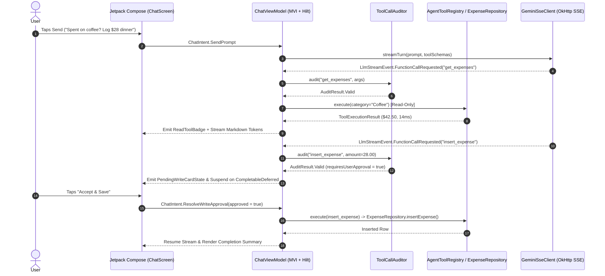

# PocketAgent ✦ — Agentic Android Architecture Showcase

An AI-first personal finance assistant built with **Kotlin**, **Jetpack Compose**, **Dagger Hilt**, **Clean Architecture (MVI + Repository Pattern)**, and **Room**. 

Instead of acting as a passive text chatbot, **PocketAgent** demonstrates **on-device MCP (Model Context Protocol) tool calling**, **lossless SSE token streaming**, **deterministic hallucination guardrails**, and **Human-in-the-Loop (HITL) coroutine suspension** for mutating database operations.

---

## ✨ Key Architectural Highlights

1. **Lossless SSE Token Streaming (`callbackFlow` + `.scan()`)**
   - Streams real-time Server-Sent Events (SSE) from `gemini-3.8-flash` over OkHttp without third-party AI SDK wrappers.
   - Separates **upstream delta accumulation** (via `.scan()` on `@DefaultDispatcher`) from **UI state emission** (`StateFlow`), preventing dropped tokens under main-thread contention while avoiding redundant recompositions.
   - Guarantees deterministic socket teardown via `awaitClose { eventSource.cancel() }` and `withContext(NonCancellable)` when the user taps **Stop Generation** mid-stream.

2. **Dependency Injection with Dagger Hilt & Repository Pattern**
   - Standardized DI with Hilt (`@HiltAndroidApp`, `@AndroidEntryPoint`, `@HiltViewModel`).
   - Modularized Dagger components (`DatabaseModule`, `RepositoryModule`, `DispatchersModule`) for zero-boilerplate singleton management and seamless testability.
   - Clean Architecture [`ExpenseRepository`](file:///Users/beka/AndroidStudioProjects/PocketAgent/app/src/main/java/com/bekacodes/pocketagent/data/repository/ExpenseRepository.kt) abstraction isolating presentation logic from Room SQLite queries, with all suspending data operations wrapped in `runCatching` blocks on `@IoDispatcher`.

3. **On-Device MCP Tool Registry (`AgentToolRegistry`)**
   - Exposes local SQLite capabilities (`get_expenses`, `insert_expense`, `delete_last_expense`, `clear_all_expenses`) to the LLM via declarative JSON Schemas.
   - Distinguishes between **Read-Only Tools** (auto-executed mid-stream with sub-20ms measured latency badges) and **Mutating Write Tools** (suspended for explicit user confirmation).

4. **Human-in-the-Loop (HITL) Coroutine Suspension (`CompletableDeferred`)**
   - When the agent proposes a database mutation (`INSERT_EXPENSE`, `DELETE_LAST_ROW`, or `CLEAR_ALL_EXPENSES`), the streaming pipeline suspends inline on a `CompletableDeferred<Boolean>` and emits `MessageStreamStatus.AwaitingApproval`.
   - Jetpack Compose renders an interactive **Accept & Save / Reject** confirmation card inside the active message bubble. Once resolved by the user, the coroutine resumes and streams the final confirmation.

5. **Deterministic Guardrails & Context Budgeting (`ToolCallAuditor` & `ContextWindowManager`)**
   - Audits all LLM-generated tool arguments prior to execution—blocking hallucinated tool names, negative/NaN amounts, and out-of-bounds payloads.
   - Tracks real-time token consumption in the top bar (`1.4k / 8k tkns`) with sliding-window turn pruning.

6. **Dual-Engine Runtime (`Demo Sim` vs. `Gemini Live`)**
   - **Demo Sim Mode:** Zero-config offline simulator that executes real Room SQLite queries and triggers HITL approval cards out of the box—no API key required to evaluate the repo.
   - **Gemini Live Mode:** Connects to the live Google Gemini SSE endpoint (`gemini-3.8-flash`).

---

## 🏗️ End-to-End Streaming & Tool Execution Flow



---

## 📂 Project Structure

```text
com.bekacodes.pocketagent
├── PocketAgentApplication.kt           # Custom Application class (@HiltAndroidApp)
├── MainActivity.kt                     # Single Activity entry point (@AndroidEntryPoint)
├── data
│   ├── ExpenseDatabase.kt              # Room entities, DAO, and database instance
│   ├── GeminiSseClient.kt              # Raw OkHttp SSE client with awaitClose socket cancellation
│   ├── LlmStreamEvent.kt               # Stream event model hierarchy
│   └── repository
│       ├── ExpenseRepository.kt        # Repository domain contract interface
│       └── ExpenseRepositoryImpl.kt    # Thread-safe repository implementation on @IoDispatcher
├── di
│   ├── CoroutinesQualifiers.kt         # Custom dispatcher qualifiers (@IoDispatcher, @DefaultDispatcher)
│   ├── DispatchersModule.kt            # Hilt module providing CoroutineDispatchers
│   ├── DatabaseModule.kt               # Hilt module providing Database, DAO, Registry, and SSE Client
│   └── RepositoryModule.kt             # Hilt module binding ExpenseRepositoryImpl to ExpenseRepository
├── domain
│   ├── AgentToolRegistry.kt            # MCP tool contracts, JSON schemas & Room tool implementations
│   ├── ToolCallAuditor.kt              # Deterministic hallucination & bounds validation layer
│   └── ContextWindowManager.kt         # Heuristic token estimator & sliding-window turn pruner
└── ui
    ├── DatabaseInspectorSheet.kt       # Live SQLite modal bottom sheet highlighting agent writes
    └── presentation/chat
        ├── ChatViewModel.kt            # @HiltViewModel managing MVI StateFlow & SSE streaming
        ├── ChatScreen.kt               # Stateless Material 3 dark UI & cached Markdown renderer
        ├── components
        │   ├── PocketAgentTopBar.kt    # App bar with token counter & mode toggle
        │   ├── EngineModePill.kt       # Mode pill toggle button
        │   ├── ChatBottomBar.kt        # Prompt bar with action suggestions & send/stop button
        │   ├── AgentMessageItem.kt     # Agent message item with tool badges & approval card
        │   └── UserMessageBubble.kt    # User chat bubble component
        └── model
            ├── ChatUiState.kt          # @Immutable MVI UI state model
            ├── ChatIntent.kt           # User intents and actions
            ├── ChatMessageUiModel.kt   # Sealed message hierarchy
            └── ReadToolBadge.kt        # UI badge model for executed read tools
```

---

## 🚀 Getting Started

1. **Clone & Run Immediately (Zero Config):**
   Open the project in Android Studio and press **Run**. If no API key is present, the app automatically boots in **Demo Sim** mode against the local Room database.
2. **Enable Gemini Live Mode (Optional):**
   Add a free [Google AI Studio](https://aistudio.google.com/) key to your root `local.properties`:
   ```properties
   GEMINI_API_KEY=AIzaSyYourKeyHere
   ```
3. **Run the Unit Test Suite:**
   ```bash
   ./gradlew testDebugUnitTest
   ```
   Verifies `CompletableDeferred` approval suspension, mid-stream `StopGeneration` cancellation cleanup, `ExpenseRepository` queries, and `ToolCallAuditor` guardrails using `kotlinx-coroutines-test` and `Turbine`.
